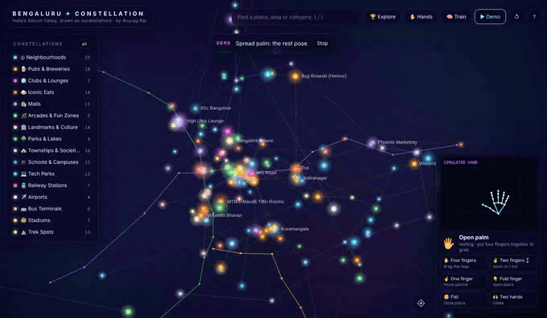

# Gesture City Map

**A constellation map of any city that you fly with your hands, right in the browser.** Swipe, pinch, point and give a thumbs up. Swap in your own city by editing one file.



**[Live demo](https://anuragraj12.github.io/gesture-city-map/)** · [London example](https://anuragraj12.github.io/gesture-city-map/?city=london) · [Watch the demo](https://anuragraj12.github.io/gesture-city-map/?demo) (no camera needed)

No install, no build step, no server code. Hand tracking runs on your device with [MediaPipe](https://ai.google.dev/edge/mediapipe/solutions/vision/hand_landmarker), so no video ever leaves your browser.

---

## Gestures

| Gesture | What it does |
|---|---|
| 🖐️ **Swipe your open palm** left, right, up or down | Moves the map that way |
| 🤏 **Pinch out** (thumb and index apart) | Zooms in |
| 🤏 **Pinch in** (thumb and index together) | Zooms out |
| ☝️ **One finger** | Moves the pointer, which snaps onto the nearest place |
| 👍 **Thumbs up** (hold ⅓ s) | Opens the place under the pointer (or presses the button under it) |
| ✊ **Fist** (hold ⅓ s) | Closes the open place |
| 🙌 **Two hands**, turned like a steering wheel | Rotates the map |

Mouse, touch and keyboard work too: drag, scroll or pinch to zoom, two-finger twist to rotate, click to open, <kbd>Esc</kbd> to close, <kbd>Q</kbd>/<kbd>E</kbd> to rotate, <kbd>/</kbd> to search.

## Make it your city

1. **Copy the template:** `cities/_template.js` → `cities/pune.js` (lowercase, no spaces).
2. **Add your places.** Each one needs a name, a category, `lat` and `lng`. Right-click any spot in Google Maps to copy its coordinates.
   ```js
   { name: "Shaniwar Wada", cat: "sights", lat: 18.5195, lng: 73.8553, rank: 3, area: "Kasba Peth", note: "Peshwa-era fort" }
   ```
3. **Open it** with `index.html?city=pune`, or set `data-city="pune"` at the top of `index.html` to make it the default.

**Prefer a spreadsheet?** Export a CSV with `name, category, lat, lng, rank, area, note` columns and convert it:

```bash
node tools/csv-to-city.mjs my-places.csv --name "Pune" > cities/pune.js
```

<details>
<summary><b>Every config field</b></summary>

| Field | Required | What it is |
|---|---|---|
| `name` | ✓ | City name, used in the intro |
| `categories` | ✓ | `key: { label, color, icon }`. Each category becomes its own constellation |
| `places` | ✓ | `{ name, cat, lat, lng, rank, area, note, approx }`, or the short form `[name, cat, lat, lng, rank, area, note]` |
| `title`, `subtitle`, `credit` | | Text in the top-left corner |
| `center` | | `[lat, lng]` the map is measured from. Defaults to the middle of your places |
| `homeZoom` | | `>1` starts closer, `<1` further out |
| `theme` | | `{ accent, accent2 }` UI colours |
| `lines` | | Transit lines (`kind: "transit"`, `stops: [[name, lat, lng], …]`), roads (`kind: "road"`) and rivers (`kind: "water"`, `points: [[lat, lng], …]`) |

`rank` controls labels: 3 is always labelled, 2 when you zoom in a little, 1 when you zoom in a lot. A mistake in the config, like an unknown category, shows a warning and skips that place instead of breaking the map.
</details>

## Run it

- **On GitHub Pages:** fork this repo, then go to *Settings → Pages* and pick `main` / root. Your map is live at `https://<you>.github.io/gesture-city-map/`.
- **Locally:** any static server works, for example `npx serve` or `python3 -m http.server`, then open `http://localhost:8000`. The camera needs `https://` or `localhost`.

Hand tracking works best in Chrome or Edge, in good light, with your hand 40–70 cm from the camera.

## How the gestures stay reliable

The gesture engine (`src/gestures.js`) is plain JavaScript with no DOM, so it's easy to read, tune and test.

- **Shape, not position.** Finger poses come from MediaPipe's 3-D *world* landmarks, so they read the same near or far, and with a tilted hand.
- **Hysteresis.** A new pose must hold for a few frames before it counts, so one bad frame can't trigger anything.
- **Holds, not flicks.** Thumbs up and fist fire once, after a short hold. A ring around the pointer fills while you hold.
- **The click lands where you pointed.** When your hand changes shape, the pointer rewinds to where it was just before, so curling into a thumbs up can't knock it off target.
- **Swipes need intent.** A swipe needs speed, distance and a clear direction. The return stroke is ignored.
- **No accidental zoom.** Zoom only starts once the thumb–index gap really changes, and never in the split second while your hand changes shape.
- **Two hands win.** While both hands are in view, only rotation works, and there's a short grace period after you drop one.

Every threshold lives in one `DEFAULTS` object at the top of the engine. Pass overrides with `new Gestures.Engine({ holdMs: 400 })`.

## Tests

```bash
npm test
```

The tests drive the real engine with synthetic hands (`src/synth.js`) at 30 fps. They cover every gesture, tilted and noisy hands, and the robustness rules above. The same synthetic hand powers the **▶ Demo** button.

## Project structure

```
index.html            page shell; picks the city file
cities/               one file per city (bengaluru.js, london.js, _template.js)
src/gestures.js       gesture engine: landmarks in, map commands out
src/app.js            map drawing, UI, camera, mouse, touch, keyboard, demo
src/synth.js          synthetic hand generator for tests and the demo
src/style.css         styles
tools/csv-to-city.mjs CSV → city config converter
test/                 engine tests (node --test)
```

## Privacy

The camera feed is processed in your browser and never uploaded. The MediaPipe library and model are downloaded from public CDNs when you turn on hand control.

## License

[MIT](LICENSE) © Anurag Raj. Use it, fork it, map your city. A link back is appreciated.

Bengaluru pins are approximate (usually within a few hundred metres), and venues change, so check before you head out.
